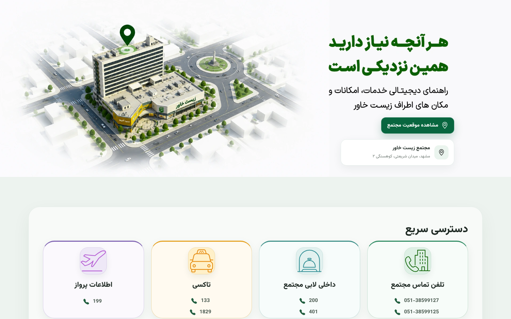
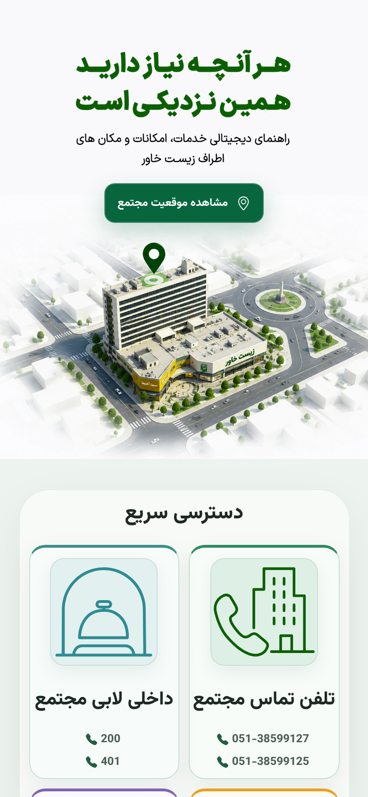

# Zist Khavar Residents' Guide

A responsive, Persian (RTL) guide website for residents and guests of the Zist Khavar residential complex in Mashhad. It gives one-tap access to emergency and building phone numbers, lists the services around the complex with directions, and shows the complex on an interactive map.

**Live site:** [qrcode.mybalaban.org](https://qrcode.mybalaban.org/)

راهنمای دیجیتال خدمات، امکانات و مکان‌های اطراف مجتمع مسکونی زیست خاور؛ طراحی و پیاده‌سازی‌شده در دوره کارآموزی در شرکت بالابان.

| Desktop | Mobile |
| --- | --- |
|  |  |

## Features

- **Quick access:** building phone lines, lobby extensions, taxi, flight and rail information, emergency numbers, plus emergency exit and garbage chute locations. Every number is a `tel:` link, so it can be called with one tap on a phone.
- **Around you:** 10 nearby services (supermarket, bakeries, mosque, metro and bus stations, and more) with driving and walking times and a route button that opens Neshan Maps.
- **Interactive map:** an embedded Neshan map of the complex's location.

## Technical notes

- Plain **HTML5 and CSS3** with no frameworks or JavaScript.
- **Responsive layout optimized for phones**, with `max-width` breakpoints at 1400, 1100, 900, 768, 640 and 420 px.
- Separate hero images for mobile and desktop using `<picture>` and `srcset`.
- **WebP** images with `loading="lazy"` for fast loading on mobile data.
- Semantic sections with `aria-labelledby`, decorative icons hidden from screen readers, and support for `prefers-reduced-motion`.
- Self-hosted [Vazirmatn](https://github.com/rastikerdar/vazirmatn) variable font (SIL Open Font License).

## Run locally

No build step is needed. Open `index.html` in a browser, or serve the folder:

```sh
npx serve .
```

## Structure

```
index.html          page markup
style.css           all styles and breakpoints
assets/backgrounds  hero images (desktop and mobile)
assets/images       photos of nearby places
assets/icons        SVG icons
assets/fonts        Vazirmatn font and its license
docs/               README screenshots
```

## Credits

Designed and built by **Ali Keramati** as a frontend intern at [Balaban](https://mybalaban.org).
